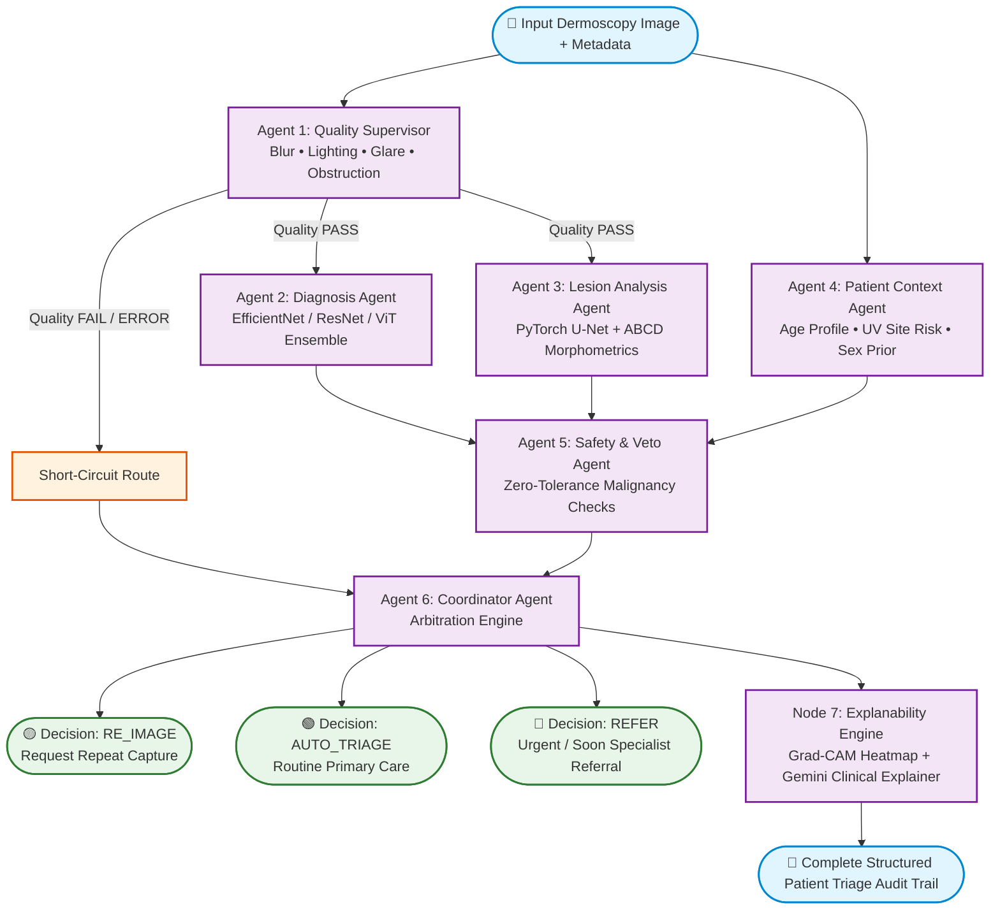

<div align="center">

# 🩺 DermaGuard

### **Autonomous, Explainable Multi-Agent Clinical Triage for Dermatology**
*Developed for the Jaypee Agentic AI International Summit 2026 — Track 2: Healthcare*

[](https://www.python.org/)
[](https://fastapi.tiangolo.com/)
[](https://langchain-ai.github.io/langgraph/)
[](https://pytorch.org/)
[](#agent-5-clinical-safety--veto-engine)
[](#-interactive-demo-dashboard)

<p align="center">
  <a href="#-overview">Overview</a> •
  <a href="#-system-architecture">Architecture</a> •
  <a href="#-the-6-specialized-agents">The 6 Agents</a> •
  <a href="#-interactive-demo-dashboard">Demo Dashboard</a> •
  <a href="#-quickstart--installation">Quickstart</a> •
  <a href="#-api-reference">API Reference</a> •
  <a href="#-cli--evaluation-pipeline">CLI & Evaluation</a> •
  <a href="#-supported-lesion-classes">Classes</a>
</p>

---

</div>

> [!WARNING]
> **CRITICAL MEDICAL SAFETY NOTICE**
> 
> DermaGuard is an investigational research prototype and clinical decision-support pipeline designed for evaluation and benchmarking. **It is not an FDA/CE-cleared medical device and must never be used as a standalone diagnostic tool or as a substitute for certified dermatological consultation.** Any clinical workflow utilizing this tool must maintain qualified clinician oversight ("human-in-the-loop").

---

## 🌟 Overview

Dermatology faces a dual clinical bottleneck: overburdened specialist clinics leading to life-threatening delays for malignant lesions (such as melanoma), and high false-alarm rates from inexperienced triage points. Automated single-model classifiers often fail silently when given blurry images, out-of-context patient features, or edge cases.

**DermaGuard** solves this by decomposing clinical dermatological triage into a **collaborative 6-agent LangGraph workflow**. Rather than relying on a single black-box prediction, DermaGuard mirrors clinical hospital rounds:

1. **Gatekeeping image quality** before spending expensive model compute.
2. **Predicting ISIC-standard diagnoses** with deep learning ensemble probabilities.
3. **Quantifying objective biophysical ABCD morphometrics** (Asymmetry, Border irregularity, Color variation, Diameter) through U-Net segmentation.
4. **Contextualizing patient epidemiological risk** (age, anatomical site UV exposure, biological sex).
5. **Enforcing strict zero-tolerance safety guardrails** with an independent veto engine.
6. **Arbitrating final disposition** into one of three Track 2 triage decisions:
   - 🟢 `AUTO_TRIAGE` — High-confidence, verified benign lesions safely cleared for routine primary care.
   - 🔴 `REFER` — Suspected malignancies, high-risk phenotypes, or safety vetoes routed to urgent specialist review.
   - 🟡 `RE_IMAGE` — Blurry, underexposed, specular-glare, or occluded captures flagged for immediate re-acquisition.
7. **Explaining decisions** via **Grad-CAM visual attention overlays** and **multimodal Gemini clinical rationales**.

---

## 🏗️ System Architecture

DermaGuard is orchestrated as a stateful, typed directed graph using **LangGraph StateGraph** and **Pydantic / TypedDict** schemas (`DermaGuardState`). 



### Graph Execution Highlights

- **Parallel Fan-Out**: Upon ingestion, Image Quality screening (Agent 1) and Patient Context reasoning (Agent 4) execute concurrently.
- **Fail-Fast Quality Router**: If image quality drops below diagnostic thresholds, the pipeline immediately short-circuits to the Coordinator, returning `RE_IMAGE` with exact failure reasons (e.g., severe motion blur or specular glare). This eliminates unnecessary GPU inference and prevents diagnostic errors.
- **Multimodal Feature Fusion**: For diagnostic-grade images, deep learned feature representations (Agent 2) are paired with physical morphological measurements (Agent 3) and demographic risk scores (Agent 4).
- **Conservative Veto Engine**: Safety Agent 5 acts as an ombudsman with veto power over optimistic predictions.

---

## 🤖 The 6 Specialized Agents

### Agent 1: Image Quality Supervisor
*Location: [`image_quality_agent/`](image_quality_agent/)*
* **Role**: Deterministic gatekeeper guarding against poor acquisition artifacts.
* **Checks**:
  - **Laplacian Blur**: Evaluates high-frequency spatial gradients to detect motion or optical blur.
  - **Lighting & Illumination**: Inspects mean luminosity and luminance histogram distribution (underexposure / overexposure).
  - **Specular Glare**: Detects saturated white hotspots that wash out pigmentation networks.
  - **Obstructions**: Identifies hair coverage, dermatoscope borders, ruler marks, and skin markers.
* **Output**: `PASS` / `FAIL`, composite score $[0.0, 1.0]$, and specific failed sub-checks.

### Agent 2: Diagnosis Agent
*Location: [`diagnosis_agent/`](diagnosis_agent/)*
* **Role**: 7-class ISIC lesion classifier trained on HAM10000.
* **Model Backbone**: EfficientNet-B0 / B3, ResNet-50, and Vision Transformer (ViT-Small) with Test-Time Augmentation (TTA: horizontal/vertical flips).
* **Target Classes**: `akiec`, `bcc`, `bkl`, `df`, `mel`, `nv`, `vasc`.
* **Output**: Calibrated class probabilities, primary prediction, confidence score, and dedicated melanoma/malignancy probability flags.

### Agent 3: Lesion Analysis Agent
*Location: [`lesion_analysis_agent/`](lesion_analysis_agent/)*
* **Role**: Biophysical segmentation and objective ABCD rule extraction.
* **Features**:
  - **Segmentation**: Deep PyTorch U-Net with automatic fallback to adaptive morphological Otsu thresholding.
  - **Asymmetry (A)**: Bisects the lesion contour across major/minor principal axes to compute geometric overlap disparity.
  - **Border (B)**: Computes isoperimetric compactness $P^2 / (4\pi A)$ and boundary irregularity.
  - **Color (C)**: Analyzes RGB and HSV variance, identifying variegation across brown, black, red, white, and blue-gray veils.
  - **Diameter & Area (D)**: Calculates equivalent pixel diameter, bounding dimensions, and lesion area fraction.
* **Output**: Suspicion score $[0.0, 1.0]$, suspicion tier (`LOW`, `MODERATE`, `HIGH`), and reliability flags.

### Agent 4: Reasoning & Patient Context Agent
*Location: [`reasoning_context_agent/`](reasoning_context_agent/)*
* **Role**: Clinical risk stratification based on epidemiological and anatomical factors.
* **Logic**:
  - **Age Stratification**: Evaluates age cohorts (pediatric/young adult vs. $>60$ years with elevated incidence of melanoma and non-melanoma skin cancer).
  - **Anatomical UV Exposure Tiers**: High-risk sun-exposed areas (face, scalp, ears, neck, upper back) vs. lower-risk sites.
  - **Biological Sex Prior**: Incorporates site-specific risk adjustments (e.g., lower extremity in females, trunk/back in males).
* **Output**: Patient risk score $[0.0, 1.0]$, indicator (`LOW`, `MODERATE`, `HIGH`), and clinical notes.

### Agent 5: Clinical Safety & Veto Engine
*Location: [`safety_agent/`](safety_agent/)*
* **Role**: Zero-tolerance safety policy enforcement and cross-agent conflict resolution.
* **Safety Rules**:
  - **Malignancy Probability Override**: Any lesion with melanoma probability $P(\text{mel}) \ge 0.15$ or basal cell carcinoma probability $P(\text{bcc}) \ge 0.20$ triggers an immediate safety flag.
  - **Morphological Disparity Veto**: If Agent 2 predicts benign nevus (`nv`), but Agent 3 calculates high ABCD suspicion ($>0.60$), the safety agent issues a **VETO**, forcing specialist referral.
  - **Context-Mismatch Protection**: Elevated patient risk combined with high diagnostic entropy or borderline confidence triggers escalation.
* **Output**: `must_refer` boolean, `veto` trigger list, severity tier (`CLEAR`, `WARN`, `VETO`), and clinical justification.

### Agent 6: Coordinator Agent
*Location: [`coordinator_agent/`](coordinator_agent/)*
* **Role**: Final triage decision synthesis and multi-criteria arbitration.
* **Decision Matrix**:
  - **`RE_IMAGE`**: Triggered when Agent 1 fails image quality. Short-circuits further inference.
  - **`REFER`**: Triggered when a malignancy is predicted, Agent 5 issues a veto/safety flag, ABCD suspicion is high, or diagnosis confidence is low.
  - **`AUTO_TRIAGE`**: Reserved strictly for high-confidence benign predictions (`nv`, `bkl`, `df`, `vasc`) with pristine image quality, low ABCD suspicion, and clear safety checks.
* **Output**: Final decision, clinical urgency (`ROUTINE`, `SOON`, `URGENT`, `REPEAT_IMAGE`), confidence tier, and decision rule.

### Explanability Engine: Grad-CAM & Gemini Explainer
*Location: [`explanation/`](explanation/)*
* **Visual Attention**: PyTorch Grad-CAM extracts spatial gradients from the final convolutional layer, producing high-resolution heatmaps overlaid on the lesion. Quantifies the percentage of attention focused inside the segmented lesion boundary.
* **Clinical Rationale**: Google Gemini multimodal LLM (with offline deterministic fallback) translates multi-agent technical telemetry into actionable, structured clinical summaries.

---

## 🖥️ Interactive Demo Dashboard

DermaGuard includes a built-in, browser-accessible visual clinical dashboard.

To launch the dashboard:

```bash
uvicorn app:app --host 0.0.0.0 --port 8000 --reload
```

Open **`http://127.0.0.1:8000/demo`** in your browser.

```text
┌──────────────────────────────────────────────────────────────────────────────┐
│  🩺 DermaGuard AI — Interactive Clinical Triage & Grad-CAM Heatmap Demo       │
├──────────────────────────────┬───────────────────────────────────────────────┤
│  📁 Case Ingestion           │  📊 Multi-Agent Clinical Evaluation           │
│                              │                                               │
│  [Drag & Drop Dermoscopy]    │  Final Decision: [ REFER ]  Urgency: [ URGENT ]│
│  Patient Age: [ 58 ]         │  Primary Diagnosis: Melanoma (mel) (94.2%)    │
│  Patient Sex: [ Male ▼ ]     │  Quality Status: PASS (Score: 0.96)           │
│  Site: [ Back ▼ ]            │  ABCD Suspicion: HIGH (Score: 0.81)           │
│  Heatmap Colormap: [ Jet ▼ ] │  Safety Veto: TRIGGERED (Malignancy Risk)     │
│                              │                                               │
│  [ Run 6-Agent Analysis ]    │  Grad-CAM Heatmap & Attention Focus: 96.4%   │
│                              │  [Original Image] ────► [Visual CAM Overlay]  │
└──────────────────────────────┴───────────────────────────────────────────────┘
```

**Dashboard Features:**
- Real-time drag-and-drop dermoscopy image upload.
- Customizable patient demographic inputs (age, sex, anatomical location).
- Interactive colormap switching (`Jet` clinical classic vs. `Turbo` high-contrast).
- Comprehensive multi-agent breakdown cards:
  - Quality metrics (blur, illumination, glare, occlusion).
  - Diagnosis probability bar chart across all 7 ISIC classes.
  - ABCD morphometrics table (asymmetry, border, color, diameter).
  - Safety triggers and veto rationale.
- Side-by-side original dermoscopy vs. Grad-CAM visual attention overlay.
- Natural language clinical report.

---

## 🚀 Quickstart & Installation

### 1. Prerequisites
- **Python**: 3.10 or newer (tested on 3.10, 3.11, 3.12, 3.14)
- **OS**: macOS, Linux, or Windows (WSL recommended)
- **Hardware**: CPU supported; CUDA-capable GPU recommended for high-throughput batch inference.

### 2. Environment Setup

```bash
# Clone the repository
git clone https://github.com/aryanvarshney/DermaGuard.git
cd DermaGuard

# Create and activate a virtual environment
python -m venv .venv
source .venv/bin/activate       # On Windows: .venv\Scripts\activate

# Upgrade pip and install core dependencies
python -m pip install --upgrade pip
python -m pip install \
  fastapi uvicorn python-multipart pydantic \
  langgraph httpx pillow numpy opencv-python \
  torch torchvision pytest
```

### 3. Model Weights & API Keys (Optional)

DermaGuard is modular and will run heuristic baselines if no weights are provided. For full deep learning inference:

```bash
# Place your trained PyTorch checkpoint in any of these default paths:
mkdir -p checkpoints
cp /path/to/efficientnet_b0_best.pth checkpoints/efficientnet_b0_best.pth

# Set optional Gemini API key for live LLM clinical explanations:
export GEMINI_API_KEY="your-google-gemini-api-key"
```

---

## 📡 API Reference

Start the production FastAPI service:

```bash
uvicorn app:app --host 0.0.0.0 --port 8000 --reload
```

| Method | Endpoint | Description |
|---|---|---|
| `POST` | `/api/analyze` | Full 6-agent triage, ABCD analysis, and Grad-CAM generation |
| `POST` | `/api/quality-check` | Standalone technical image quality screening (Agent 1) |
| `POST` | `/api/gradcam` | Standalone Grad-CAM heatmap visualization |
| `GET` | `/api/classes` | Reference metadata and definitions for all 7 ISIC classes |
| `GET` | `/demo` | Interactive in-browser testing dashboard |
| `GET` | `/health` | Service health status and model availability |
| `GET` | `/docs` | Interactive Swagger UI API documentation |
| `GET` | `/redoc` | OpenAPI ReDoc specification |

### Example 1: Full Analysis via cURL

```bash
curl -X POST "http://127.0.0.1:8000/api/analyze" \
  -F "file=@sample_lesion.jpg" \
  -F "age=54" \
  -F "sex=male" \
  -F "localization=back" \
  -F "include_gradcam=true" \
  -F "colormap=jet"
```

### Example 2: Python `requests` Integration

```python
import requests

url = "http://127.0.0.1:8000/api/analyze"
files = {"file": open("sample_lesion.jpg", "rb")}
data = {
    "age": 48,
    "sex": "female",
    "localization": "lower extremity",
    "include_gradcam": True
}

response = requests.post(url, files=files, data=data)
result = response.json()

print(f"Decision: {result['decision']}")          # AUTO_TRIAGE | REFER | RE_IMAGE
print(f"Prediction: {result['predicted_label']}")  # nv, mel, bcc, etc.
print(f"Urgency: {result['urgency']}")            # ROUTINE | SOON | URGENT | REPEAT_IMAGE
print(f"Rationale: {result['rationale']}")
```

### Example 3: JavaScript / TypeScript Frontend Integration

```javascript
const formData = new FormData();
formData.append("file", fileInput.files[0]);
formData.append("age", "54");
formData.append("sex", "male");
formData.append("localization", "back");
formData.append("include_gradcam", "true");

const response = await fetch("http://127.0.0.1:8000/api/analyze", {
  method: "POST",
  body: formData,
});

const data = await response.json();
console.log("Track 2 Decision:", data.decision);

// Render Grad-CAM overlay directly in an HTML image tag:
document.getElementById("heatmap").src = data.visualizations.gradcam_overlay;
```

### Response JSON Schema (Truncated Sample)

```json
{
  "image_id": "CASE_001",
  "predicted_label": "mel",
  "decision": "REFER",
  "urgency": "URGENT",
  "decision_rule": "RULE_SAFETY_OVERRIDE_MALIGNANCY",
  "confidence_tier": "HIGH",
  "rationale": "Malignant melanoma predicted with high confidence (0.94). Safety agent veto active.",
  "visualizations": {
    "gradcam_overlay": "data:image/jpeg;base64,/9j/4AAQSkZJRg...",
    "focus_inside_lesion_pct": 94.8,
    "target_class": "mel",
    "target_class_name": "Melanoma"
  },
  "agent1_quality": {
    "status": "PASS",
    "score": 0.942,
    "failed_checks": []
  },
  "agent2_diagnosis": {
    "predicted_class": "mel",
    "predicted_label": "Melanoma",
    "confidence": 0.942,
    "melanoma_flag": true,
    "probabilities": {
      "mel": 0.942,
      "nv": 0.031,
      "bkl": 0.015,
      "bcc": 0.008,
      "akiec": 0.002,
      "vasc": 0.001,
      "df": 0.001
    }
  },
  "agent3_morphology": {
    "asymmetry_index": 0.72,
    "border_irregularity": 0.65,
    "color_variation": 0.81,
    "suspicion_score": 0.76,
    "suspicion_level": "HIGH"
  },
  "agent4_patient_context": {
    "risk_score": 0.75,
    "risk_indicator": "HIGH"
  },
  "agent5_safety": {
    "veto": true,
    "must_refer": true,
    "severity": "VETO",
    "triggers": ["SUSPECTED_MELANOMA_HIGH_PROBABILITY"]
  }
}
```

---

## 💻 CLI & Evaluation Pipeline

### 1. Single Image CLI Evaluation

Run the complete 6-agent graph on any local image via [`run_dermaguard.py`](run_dermaguard.py):

```bash
# Human-readable clinical summary
python run_dermaguard.py \
  --image results/natural_test_lesion.jpg \
  --id TEST_001 \
  --age 58 \
  --sex male \
  --site back

# Machine-readable JSON output
python run_dermaguard.py \
  --image results/natural_test_lesion.jpg \
  --json
```

### 2. Full Six-Agent Batch Evaluation

Run the validation benchmark across a dataset split via [`six_agent_pipeline.py`](six_agent_pipeline.py):

```bash
python six_agent_pipeline.py \
  --val-csv /path/to/validation_metadata.csv \
  --image-dir /path/to/HAM10000_images/ \
  --model checkpoints/efficientnet_b0_best.pth \
  --out results/evaluation_results.csv \
  --api-submission results/final_submission.csv
```

The pipeline generates the exact Track 2 submission CSV format:

```csv
image_id,predicted_label,decision
ISIC_0024306,nv,AUTO_TRIAGE
ISIC_0024307,bkl,REFER
ISIC_0024308,mel,REFER
ISIC_0024309,nv,RE_IMAGE
```

---

## 🏷️ Supported Lesion Classes

DermaGuard recognizes the 7 international consensus lesion categories from the ISIC / HAM10000 benchmarks:

| Code | Clinical Diagnosis | Nature | Baseline Triage Action |
|:---:|---|:---:|:---:|
| `mel` | **Melanoma** | Malignant | 🔴 Mandatory `REFER` (Urgent) |
| `bcc` | **Basal Cell Carcinoma** | Malignant | 🔴 Mandatory `REFER` (Soon) |
| `akiec` | **Actinic Keratosis / Bowen's Disease** | Pre-malignant | 🔴 `REFER` (Specialist Review) |
| `nv` | **Melanocytic Nevus** (Common Mole) | Benign | 🟢 Candidate `AUTO_TRIAGE` |
| `bkl` | **Benign Keratosis** (Solar Lentigo / Seborrheic) | Benign | 🟢 Candidate `AUTO_TRIAGE` |
| `df` | **Dermatofibroma** | Benign | 🟢 Candidate `AUTO_TRIAGE` |
| `vasc` | **Vascular Lesion** (Angioma, Hemangioma) | Benign | 🟢 Candidate `AUTO_TRIAGE` |

---

## 🧪 Testing & Verification

DermaGuard includes a synthetic unit test suite for the image quality agent:

```bash
python -m pytest image_quality_agent/tests/test_quality.py -v
```

The tests generate deterministic synthetic patterns covering edge cases:
- High-frequency sharp checkerboards (`PASS`)
- Gaussian-filtered blurred images (`FAIL: BLUR`)
- Saturated overexposed white patches (`FAIL: GLARE`)
- Synthetic dark/underexposed images (`FAIL: LIGHTING`)

---

## 📁 Repository Structure

```text
DermaGuard/
├── app.py                         # FastAPI backend & interactive HTML demo dashboard
├── run_dermaguard.py              # CLI runner for the 6-agent LangGraph workflow
├── six_agent_pipeline.py          # Batch evaluator & Track 2 CSV submission generator
├── pipeline.py                    # Legacy single/batch evaluation pipeline
├── extract_and_test_model.py      # Checkpoint inspection and extraction utility
├── agent2_diagnosis.ipynb         # Diagnostic model training & calibration notebook
├── eval_pipeline.ipynb            # Full 6-agent summit evaluation notebook
├── API_DOCUMENTATION.md           # API endpoints, request schemas, & integration guide
│
├── coordinator_agent/             # Agent 6: LangGraph orchestrator & decision engine
│   ├── coordinator_agent.py       # Multi-agent arbitration rules
│   └── langgraph_coordinator.py   # StateGraph definition, routing, & node execution
│
├── image_quality_agent/           # Agent 1: Pre-screening quality supervisor
│   ├── supervisor/                # Supervisor fusion and scoring logic
│   ├── agents/                    # Blur, glare, lighting, and occlusion sub-agents
│   └── tests/                     # Pytest synthetic image test suite
│
├── diagnosis_agent/               # Agent 2: Deep learning classification ensemble
│   └── diagnosis_agent.py         # PyTorch inference, TTA, & probability calibration
│
├── lesion_analysis_agent/         # Agent 3: Biophysical segmentation & ABCD analysis
│   ├── unet.py                    # PyTorch U-Net architecture definition
│   └── lesion_analysis_agent.py   # ABCD morphometrics & Otsu fallback engine
│
├── reasoning_context_agent/       # Agent 4: Patient context & risk reasoning
│   └── reasoning_context_agent.py # Age, sex, and anatomical UV risk scoring
│
├── safety_agent/                  # Agent 5: Clinical safety ombudsman & veto engine
│   └── safety_agent.py            # Malignancy overrides & cross-agent conflict checks
│
├── explanation/                   # Explainability & Visual Attention
│   ├── gradcam.py                 # PyTorch Grad-CAM heatmap extraction
│   └── gemini_explainer.py        # Gemini multimodal clinical explainer
│
├── schema/                        # Typed contracts & data structures
│   └── dermaguard_state.py        # Pydantic models & LangGraph TypedDict state
│
└── results/                       # Sample outputs, test lesions, & evaluations
    ├── sample_cam.jpg             # Example Grad-CAM attention heatmap
    ├── natural_test_lesion.jpg    # Sample dermoscopy test image
    └── pipeline_results.summary.json # Benchmark metrics summary
```

---

## 🛡️ Safety & Ethical Considerations

1. **Failure-Resilient Design**: In the presence of ambiguous visual evidence, high entropy, or missing metadata, DermaGuard defaults to conservative escalation (`REFER`) rather than assuming benignity.
2. **Quality Barrier**: Low-quality images are rejected outright (`RE_IMAGE`), preventing dangerous automated misclassifications caused by optical artifacting.
3. **Audit Trail**: Every recommendation produces a typed state object recording individual agent scores, safety triggers, and decision rules.

---

## 📜 License

This project is developed for research, benchmarking, and demonstration purposes. See [`LICENSE`](LICENSE) (or contact the repository maintainers) for academic and clinical collaboration licensing.
